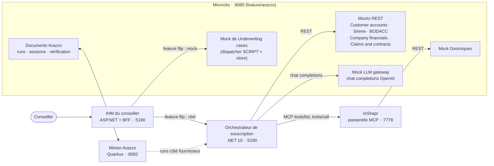
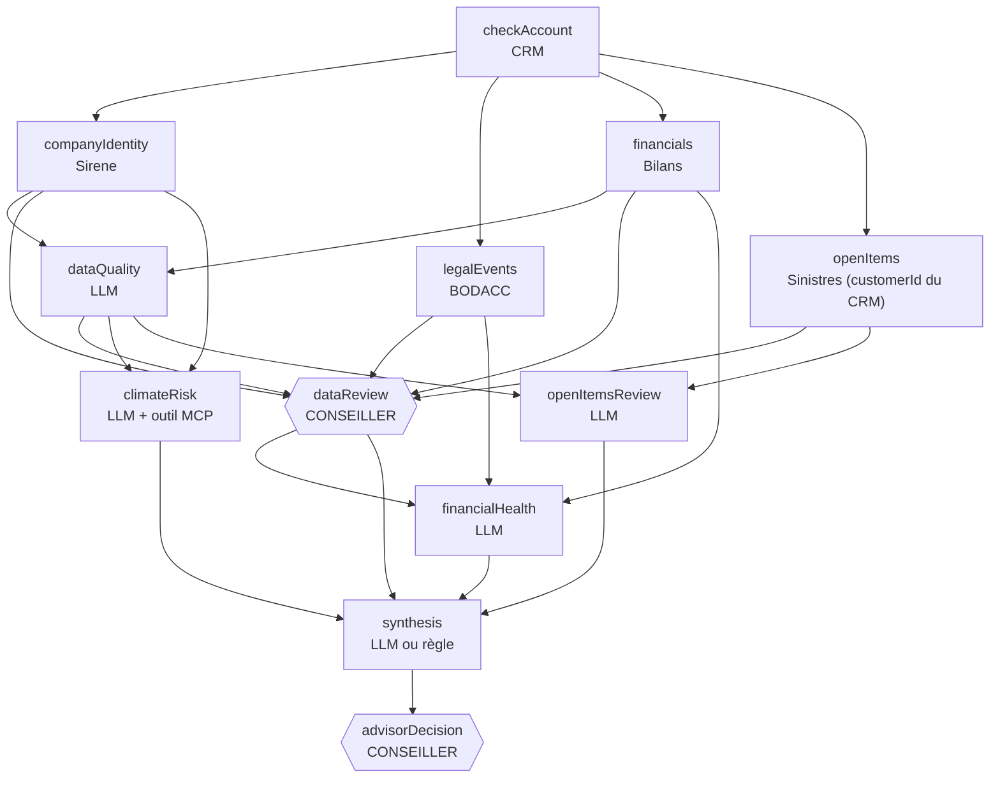
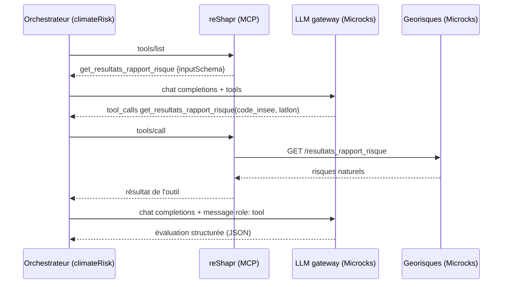
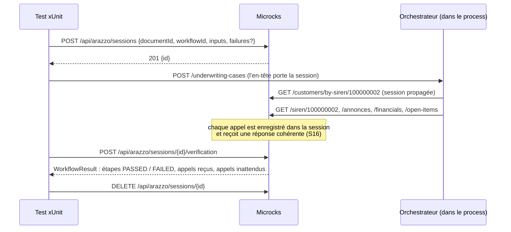

# Microcks × Arazzo — démo de souscription d'assurance entreprise

[English](README.md) · **Français**

Une démo complète et exécutable des workflows [Arazzo](https://spec.openapis.org/arazzo/latest.html) dans
[Microcks](https://microcks.io), sur un cas réaliste : un conseiller souscription ouvre un dossier d'assurance
*Multirisque Pro* pour une entreprise. Un orchestrateur .NET appelle des API de l'État et des API internes, ainsi que des
analystes LLM, à la chaîne ou en parallèle. Le conseiller reste au cœur du dossier : il valide les données collectées et
prend la décision finale. Les analyses LLM ne font qu'éclairer.

Microcks joue tous les rôles autour de l'orchestrateur :

| # | Rôle de Microcks | Où |
|---|---|---|
| 1 | **Mocke de vraies API** : CRM, Sirene (INSEE), BODACC, Géorisques, bilans, sinistres | `contracts/*.openapi.yaml` |
| 2 | **Mocke un LLM** : une API chat completions compatible OpenAI, appels d'outils compris | `contracts/llm-gateway.openapi.yaml` |
| 3 | **Sert d'API derrière un serveur MCP** : reShapr expose l'API Géorisques en outils MCP, et Microcks simule l'API derrière lui | `tools/reshapr/` |
| 4 | **Se fait passer pour l'orchestrateur** : un mock à état, piloté par le temps, de l'API de l'orchestrateur, derrière un feature flip dans l'IHM | `contracts/underwriting-cases.openapi.yaml` |
| 5 | **Teste l'orchestrateur côté fournisseur** : des workflows Arazzo jouent le parcours du conseiller contre l'orchestrateur | `contracts/underwriting.arazzo.yaml` |
| 6 | **Vérifie l'orchestrateur côté consommateur** : dans une session, Microcks vérifie que les appels sortants de l'orchestrateur suivent un workflow Arazzo (ordre, données passées d'une étape à l'autre, contrat de chaque appel), avec des pannes injectées | `tests/UnderwritingOrchestrator.WorkflowTests/` |

> [!IMPORTANT]
> Le support d'Arazzo n'est pas encore dans une version publiée de Microcks. Cette démo demande un Microcks construit
> depuis la branche `feature/arazzo` de
> [SebastienDegodez/microcks](https://github.com/SebastienDegodez/microcks/tree/feature/arazzo) (vérifiée au commit
> `2e6dde48`). Voir [Prérequis](#prérequis).

## Sommaire

- [Le scénario métier](#le-scénario-métier)
- [Architecture](#architecture)
- [L'orchestrateur](#lorchestrateur)
- [Les contrats et leurs mocks](#les-contrats-et-leurs-mocks)
- [Arazzo côté fournisseur : le parcours du conseiller](#arazzo-côté-fournisseur--le-parcours-du-conseiller)
- [Arazzo côté consommateur : les sessions et les tests .NET](#arazzo-côté-consommateur--les-sessions-et-les-tests-net)
- [L'IHM du conseiller](#lihm-du-conseiller)
- [Prérequis](#prérequis)
- [Lancer la démo](#lancer-la-démo)
- [Lancer les tests](#lancer-les-tests)
- [Configuration](#configuration)
- [Scripts](#scripts)
- [Organisation du dépôt](#organisation-du-dépôt)
- [Limites connues](#limites-connues)
- [Dépannage](#dépannage)

## Le scénario métier

Le conseiller choisit une entreprise par son SIREN et ouvre un dossier. L'orchestrateur, ensuite :

1. vérifie que l'entreprise est **cliente** (CRM) ; si elle ne l'est pas, le dossier s'arrête aussitôt ;
2. **collecte les données** en parallèle : identité légale (Sirene), annonces légales (BODACC), bilans, sinistres et
   contrats en cours ;
3. fait évaluer la **qualité des données** par un analyste LLM ;
4. attend que le **conseiller valide les données**, et corrige l'effectif déclaré si besoin ;
5. lance les **analyses** : risque climatique (un agent LLM qui appelle un outil MCP pour lire les risques naturels),
   santé financière, encours ;
6. produit une **suggestion consultative** (`synthesis`), par un LLM ou par une règle ;
7. attend la **décision du conseiller**. Quand le risque est trop important pour plusieurs raisons, la décision est
   *renforcée* : le conseiller doit reconnaître chaque raison une à une et écrire un commentaire.

Les temps sont longs et aléatoires, comme avec de vrais services : les bilans prennent 30 à 60 secondes, par exemple.
Cette latence vient de Microcks (`delay` et `delayStrategy` dans les contrats), pas de l'orchestrateur.

### Entreprises de démo

Les données sont cohérentes dans tous les mocks.

| SIREN | Entreprise | Ville | Ce qui se passe | Suggestion attendue |
|---|---|---|---|---|
| `100000001` | Boulangerie Les Délices du Port | La Rochelle | Saine, mais risque **submersion marine fort** | `ACCEPT_WITH_SURCHARGE`, +15 % |
| `100000002` | Atelier Mécanique Durand | Clermont-Ferrand | Saine, risques faibles | `ACCEPT` |
| `100000003` | Transports Express Nord | Lille | **Redressement judiciaire** au BODACC : l'orchestrateur n'appelle aucun LLM | `REFUSE` (règle) |
| `100000004` | Restaurant Le Vieux Moulin | Avignon | Finances fragiles, argiles, **3 sinistres ouverts dont 1 en contentieux**, effectif incohérent | `REVIEW`, décision renforcée |
| `999999999` | (inconnue) | — | **Pas cliente** : le dossier s'arrête après la première étape | `NOT_ELIGIBLE` (règle) |

## Architecture



- **Orchestrateur** (`orchestrator/`) : une minimal API ASP.NET Core. Toutes les URL de ses dépendances sont en
  configuration : il peut pointer vers les mocks Microcks ou vers de vraies API.
- **IHM** (`ui/`) : HTML, CSS et modules ES servis par un hôte ASP.NET minimal, avec un BFF qui relaie vers l'un ou
  l'autre backend. Pas d'étape de build front.
- **Microcks** : la webapp, sur le port 8080, porte les mocks, les documents Arazzo, les runs et les sessions.
- **Minion Arazzo** : un worker Quarkus, sur le port 8082, qui joue un workflow (runs côté fournisseur). La vérification
  côté consommateur n'en a pas besoin.
- **reShapr** ([reshapr.io](https://github.com/reshaprio/reshapr)) : transforme une API OpenAPI en serveur MCP. Ici, il
  expose l'API Géorisques, que Microcks simule derrière lui.

## L'orchestrateur

`orchestrator/` implémente `contracts/underwriting-cases.openapi.yaml` sur le port **5180**.

| Endpoint | Réponse |
|---|---|
| `POST /underwriting-cases` `{siren, product}` | 202 `{caseId: "case-<siren>", status: "IN_PROGRESS"}` |
| `GET /underwriting-cases/{caseId}` | le dossier : `status`, `pendingAction`, `steps` (avec `dependsOn` et `calls`), `recommendation`, `escalation`… |
| `POST /underwriting-cases/{caseId}/data-review` `{confirmed, corrections: {declaredHeadcount?}, comment}` | 200 le dossier ; 409 `NOT_EXPECTED` hors `DATA_REVIEW` |
| `POST /underwriting-cases/{caseId}/advisor-decision` `{finalDecision, surchargePercent?, comment, acknowledgedReasons?}` | 200 le dossier, `DECIDED` ; 400 `REASONS_NOT_ACKNOWLEDGED` ou `COMMENT_REQUIRED` ; 409 `NOT_EXPECTED` hors `DECISION` |

Les dossiers sont gardés en mémoire, un dossier vivant par SIREN.

### Ordonnancement par dépendances

Chaque étape démarre **dès que les étapes de son `dependsOn` sont terminées**. Il n'y a pas de phases bloquantes : le
numéro de phase ne sert qu'à l'affichage. Les dépendances sont déclarées dans `orchestrator/Cases/StepCatalog.cs` et
exposées dans le JSON.



`climateRisk` et `openItemsReview` peuvent partir avant que le conseiller valide les données. `financialHealth`, non :
les données financières sont sensibles.

Le `status` du dossier est recalculé à chaque changement : `IN_PROGRESS` tant qu'une étape automatique tourne, est en
file ou peut encore partir ; `WAITING_ADVISOR` quand toutes les étapes restantes attendent le conseiller.
`pendingAction` (`DATA_REVIEW`, `DECISION` ou `null`) apparaît dès que l'action est possible.

Les règles de l'orchestrateur :

- **Client inconnu** (404 du CRM) : toutes les autres étapes sont `SKIPPED`, la suggestion est `NOT_ELIGIBLE` par une
  règle, et le conseiller la confirme quand même.
- **Procédure collective** au BODACC : les données sont collectées et validées, mais aucun LLM ni MCP n'est appelé. Les
  étapes LLM sont `SKIPPED` et `synthesis` devient une règle `REFUSE`. Chaque étape LLM consulte le BODACC avant
  d'appeler le modèle.
- **Pas de retry** : un appel en échec fait échouer son étape. Chacune des 5 API est appelée une fois par dossier, le CRM
  en premier.
- **Démarrages décalés** : une étape prête attend 0,3 à 5 s avant de partir.
- **File LLM** : au plus 2 appels LLM en même temps par dossier. Au-delà, l'étape passe `QUEUED`.

### L'agent climat appelle lui-même l'outil MCP

La chaîne est : agent climat (LLM) → reShapr (MCP) → API Géorisques (mock Microcks). `climateRisk` est une boucle
d'appel d'outils générique (`orchestrator/Agents/ToolUsingAgent.cs`) :



Le client MCP parle en Streamable HTTP (JSON-RPC, protocole `2025-06-18`, `Mcp-Session-Id`). Il n'a aucun nom d'outil en
dur : c'est le modèle qui choisit l'outil parmi ceux de `tools/list`. Le LLM mocké sait demander un outil : pour l'agent
`climate-risk`, il répond par des `tool_calls` tant que la requête ne contient pas de message `role: tool`.

### Décision renforcée

Avant la décision, une règle déterministe (`orchestrator/Underwriting/RiskEscalation.cs`, pas un LLM) relève les raisons
de risque : `UNKNOWN_CUSTOMER`, `COLLECTIVE_PROCEDURE`, `CLIMATE_HIGH`, `FINANCIAL_FRAGILE`, `OPEN_LITIGATION`,
`DATA_INCONSISTENT`. Le niveau est `REINFORCED` à partir de 2 raisons, ou dès que le client est inconnu ou en procédure
collective. La décision exige alors chaque raison dans `acknowledgedReasons`, et un commentaire.

## Les contrats et leurs mocks

Tous les contrats sont générés par `scripts/generate-contracts.py`. Modifiez le générateur, pas les fichiers YAML.

| Nom Microcks (`info.title` 1.0.0) | Rôle | Opérations |
|---|---|---|
| `Customer accounts` | CRM interne | `GET /customers/by-siren/{siren}` → 200, ou 404 `CUSTOMER_NOT_FOUND` |
| `Sirene` | répertoire INSEE | `GET /siren/{siren}` |
| `BODACC` | annonces légales | `GET /annonces?siren={siren}` |
| `Georisques` | risques naturels (exposé aussi en MCP par reShapr) | `GET /resultats_rapport_risque?code_insee=…&latlon=…` |
| `Company financials` | bilans | `GET /companies/{siren}/financials` |
| `Claims and contracts` | sinistres et contrats internes | `GET /customers/{customerId}/open-items` |
| `LLM gateway` | LLM compatible OpenAI | `POST /v1/chat/completions` (`operationId: createChatCompletion`) |
| `Underwriting cases` | l'orchestrateur lui-même | les 4 endpoints ci-dessus |

Quelques techniques de mock sur lesquelles repose la démo :

- **Le dispatch du LLM** : l'orchestrateur ajoute `metadata: {agent, siren}` à chaque chat completion. Un dispatcher
  `SCRIPT` le lit et choisit l'exemple `<agent>-<siren>`, par exemple `climate-risk-100000001`. Mettez
  `LlmGateway:SendMetadata=false` face à un vrai fournisseur qui refuse ce champ.
- **La latence** : chaque opération déclare `x-microcks-operation.delay` et `delayStrategy` (`fixed`, `random`,
  `random-XX`). Un appelant peut aussi demander une latence par requête avec les en-têtes `x-microcks-delay` et
  `x-microcks-delay-strategy`. reShapr les transmet au mock Géorisques.
- **Le mock de l'orchestrateur** (`Underwriting cases`) : un dispatcher `SCRIPT` avec le store de Microcks. Le `POST`
  enregistre l'heure de départ et des durées aléatoires ; le `GET` choisit l'instantané d'après le temps écoulé ; les
  deux `POST` du conseiller enregistrent leur heure et répondent 409 hors de leur tour. Il se comporte comme
  l'orchestrateur réel, au temps près.

## Arazzo côté fournisseur : le parcours du conseiller

`contracts/underwriting.arazzo.yaml` (*Commercial underwriting*, Arazzo 1.1.0) et son overlay
`contracts/underwriting.arazzo-sources.yaml` (`kind: ArazzoSources`). L'overlay relie chaque source à une API Microcks par
nom et version, et porte les exemples nommés (un par SIREN). Le document Arazzo lui-même n'est jamais modifié à l'import.

Le workflow **joue le conseiller** : il ouvre un dossier, attend par `retry` (toutes les 2 s) que l'action attendue soit
là, poste la validation des données, puis la décision. Arazzo vérifie ainsi que l'orchestrateur **s'arrête et attend
l'humain** aux bons endroits. Au moment de `DATA_REVIEW`, par exemple, il vérifie que `financialHealth` est encore
`PENDING`.

| Workflow | Ce qu'il vérifie |
|---|---|
| `advisorValidatesThenDecides` | Le parcours complet ; le conseiller suit la suggestion ; `DECIDED` |
| `advisorOverridesSuggestion` | Le conseiller s'écarte de la suggestion avec un commentaire ; `followsRecommendation == false` |
| `decisionWithoutCommentIsRefused` | S'écarter de la suggestion sans commentaire → 400 |
| `noDecisionBeforeDataReview` | Une décision postée pendant `DATA_REVIEW` → 409 |
| `unknownCustomerNeedsNoAnalysis` | `999999999` → directement `DECISION`, tout `SKIPPED`, `NOT_ELIGIBLE` |
| `highRiskRequiresReinforcedDecision` | `100000004` → `REINFORCED` ; une décision sans les raisons → 400 ; avec → `DECIDED` |
| `collectiveProcedureSkipsAnalyses` | `100000003` → analyses `SKIPPED`, `REFUSE` par une règle |

Les mêmes workflows tournent **contre l'orchestrateur réel** (cible : implémentation `http://localhost:5180`) et **contre
le mock Microcks de l'orchestrateur** (cible : mocks). `scripts/run-arazzo.sh` rejoue tous les exemples nommés contre le
mock.

> [!NOTE]
> Avec plusieurs sources, Microcks exige que chaque `operationId` nomme sa source :
> `$sourceDescriptions.underwritingApi.createUnderwritingCase`, et non `createUnderwritingCase`.

## Arazzo côté consommateur : les sessions et les tests .NET

Le côté fournisseur vérifie ce que l'orchestrateur *répond*. Le côté consommateur vérifie ce qu'il *appelle* : a-t-il
appelé le CRM en premier, passé le `customerId` du CRM à l'API sinistres, n'a-t-il sauté aucune source, s'est-il arrêté
après un 404 ?

### Comment marche une session



- La session voyage sur chaque appel aux mocks, dans l'en-tête `x-microcks-session: <id>` ou dans le baggage W3C
  `baggage: microcks-session=<id>`.
- Microcks vérifie l'**ordre** des appels (relâché par `dependsOn`), les **données** passées d'une étape à l'autre (un
  paramètre qui doit venir de `$steps.checkAccount.outputs.customerId` doit porter cette valeur) et le **contrat** de
  chaque appel.
- **Mocks cohérents** (S16) : dans une session, les mocks reflètent les valeurs envoyées par l'application et les outputs
  des étapes précédentes.
- **Pannes injectées** (S17) : `failures: {<stepId>: <exemple>}` fait répondre une étape avec un exemple donné, pour
  cette session seulement. C'est ainsi qu'un test simule un client inconnu ou une procédure collective.

Les workflows utilisés ici :

- `orchestratorCollectsCompanyData` (*Commercial underwriting*) : `checkAccount`, puis `companyIdentity`, `legalEvents`,
  `financials` et `openItems` avec `dependsOn: [checkAccount]`. `openItems.customerId` doit venir de
  `$steps.checkAccount.outputs.customerId`.
- `customerUnknownStopsTheCase` (*Commercial underwriting*) : `checkAccount` répond 404, et aucun autre appel ne doit
  suivre.
- `collectiveProcedureStopsTheAnalyses` (*Commercial underwriting guards*, `contracts/underwriting-guards.arazzo.yaml`) :
  ce document relie aussi le `LLM gateway`, donc un seul appel LLM après une procédure collective est signalé comme appel
  inattendu.

### Propager la session sans toucher à l'orchestrateur

Les tests font tourner le vrai orchestrateur dans le process avec `WebApplicationFactory<Program>`. L'orchestrateur ne
reçoit aucune ligne de code : c'est le test qui ajoute la propagation de l'extérieur
(`tests/UnderwritingOrchestrator.WorkflowTests/Infrastructure/MicrocksSessionPropagation.cs`) :

- un `IStartupFilter` lit la session de la requête entrante (en-tête ou baggage) dans un `AsyncLocal`, qui suit le
  travail du dossier en arrière-plan ;
- `ConfigureHttpClientDefaults` ajoute un `DelegatingHandler` à chaque client `IHttpClientFactory` (REST, MCP et LLM),
  qui écrit `x-microcks-session` sur chaque appel sortant.

> [!TIP]
> En .NET 10, le **baggage W3C se propage tout seul** : un dossier posté avec `baggage: microcks-session=<id>` à un
> orchestrateur *sans* le handler porte quand même la session sur ses 11 appels sortants (5 REST, 6 LLM), y compris ceux
> qui partent après la validation des données. L'en-tête `x-microcks-session` seul ne se propage pas sans aide.

### Les tests

`tests/UnderwritingOrchestrator.WorkflowTests/` (xUnit v3, `Microcks.Testcontainers`,
`Microsoft.AspNetCore.Mvc.Testing`). Chaque test ouvre sa propre session et son propre orchestrateur : la suite tourne en
parallèle en 15 secondes environ.

| Test | Ce qu'il montre |
|---|---|
| `TheUnderwritingOrchestratorFollowsTheWorkflow` | Un dossier complet, vert, même quand les 4 appels de collecte arrivent dans un autre ordre |
| `AnOrchestratorThatSendsTheSirenToClaimsIsCaught` | Bug planté : les sinistres sont lus avec le SIREN. Le mock répond 200, l'orchestrateur ne voit rien, la vérification dit `` `openItems` path `customerId` should come from `$steps.checkAccount.outputs.customerId` (C-1002), got 100000002 `` |
| `AnOrchestratorThatSkipsBodaccIsCaught` | Bug planté : un « cache » répond à la place du BODACC → `` step `legalEvents` missing `` |
| `AnOrchestratorThatSendsTheSiretToSireneIsCaught` | Bug planté : Sirene reçoit le SIRET → `` `companyIdentity` path `siren` should come from `$inputs.siren` ``… |
| `TheOrchestratorApiHonoursTheAdvisorJourney` | Côté fournisseur : un run lancé par l'API Microcks joue le parcours du conseiller contre l'orchestrateur, pendant qu'une session vérifie ses appels sortants (il faut le minion Arazzo) |
| `AnUnknownCustomerStopsTheCase` | 404 du CRM injecté : cet appel seulement, rien après |
| `ACollectiveProcedureStopsTheAnalyses` | Procédure collective injectée : les 5 appels de collecte, aucun appel LLM |
| `TwoCasesInParallelStayIsolated` | Deux sessions en même temps sur les mêmes mocks : la panne injectée dans l'une n'atteint jamais l'autre |

Les bugs plantés sont des `DelegatingHandler` ajoutés au client typé `CompanyDataApis` de l'orchestrateur
(`Infrastructure/Sabotage.cs`) : le code de l'orchestrateur reste intact.

## L'IHM du conseiller

`ui/` sur le port **5190** : le poste de travail du conseiller.

- **Feature flip** dans l'en-tête : *Orchestrateur .NET ⇄ Microcks (mock)*, gardé en `localStorage`, avec un badge qui
  dit toujours quel backend a répondu.
- **Les deux points de contrôle du conseiller** : la validation des données (données collectées, alertes de qualité,
  correction de l'effectif) et la décision (le conseiller choisit ; la suggestion reste à côté, libellée consultative ; en
  `REINFORCED`, chaque raison est reconnue une à une).
- **Onglets** : Vue 360, Entreprise, Risques (avec une carte illustrative dessinée par la page, sans tuile externe),
  Finances, Sinistres & contrats, Parcours (couloirs dans le temps, flèches `dependsOn`, file LLM), Tableau, Journal des
  appels.
- **Mode « Comprendre »** : un panneau latéral qui anime les vrais appels à chaque poll : paquets de requêtes, cadre
  Microcks, reShapr en dehors, POST du conseiller. En mode mock, seul l'échange IHM ⇄ Microcks bouge, car rien n'est
  appelé en aval.

Les routes du BFF : `/bff/orchestrator/**` → `:5180`, `/bff/microcks/**` → le mock `Underwriting cases`, `/bff/health`.
Paramètres d'URL : `?backend=orchestrator|microcks`, `&comprendre=1`, `&tab=timeline`.

## Prérequis

| Outil | Pour |
|---|---|
| SDK .NET 10 | orchestrateur, IHM, tests |
| Java 25 et Maven | construire Microcks depuis `feature/arazzo` |
| Docker (Compose v2.24+) | MongoDB, reShapr, Testcontainers |
| Node.js, `curl`, `jq` | CLI reShapr, scripts |
| Python 3 | `scripts/generate-contracts.py` (seulement pour régénérer les contrats) |

### Construire Microcks avec Arazzo

```bash
git clone -b feature/arazzo https://github.com/SebastienDegodez/microcks.git microcks-feature-arazzo
cd microcks-feature-arazzo
mvn -Pprod -DskipTests install

# Image uber, pour les tests Testcontainers
docker build -f distro/uber/src/main/docker/Dockerfile -t microcks-uber:feature-arazzo distro/uber
```

### Lancer Microcks et le minion Arazzo

La démo attend Microcks sur `http://localhost:8080`, sans authentification, et le minion Arazzo sur
`http://localhost:8082`. Une façon de faire, à partir des jars construits :

```bash
docker run -d --name microcks-arazzo-mongo -p 27017:27017 mongo:4.4.29

KEYCLOAK_ENABLED=false ARAZZO_MINION_URL=http://localhost:8082 \
  java -jar webapp/target/microcks-app-*-exec.jar

java -Dquarkus.http.port=8082 -Dmicrocks.url=http://localhost:8080 \
  -jar minions/arazzo/target/quarkus-app/quarkus-run.jar
```

> [!NOTE]
> La webapp lit `arazzo-minion.url` sans valeur par défaut : définissez toujours `ARAZZO_MINION_URL`, même quand aucun
> minion ne tourne.

## Lancer la démo

```bash
scripts/start-demo.sh
```

Le script vérifie Microcks et le minion, démarre reShapr si besoin (`scripts/start-reshapr.sh`), importe les contrats
(`scripts/import-contracts.sh`), puis construit et démarre l'orchestrateur et l'IHM.

| Quoi | URL |
|---|---|
| IHM du conseiller | http://localhost:5190 |
| Orchestrateur | http://localhost:5180 |
| Workflows dans Microcks | http://localhost:8080/#/workflows (document *Commercial underwriting*) |
| Console reShapr | http://localhost:5555 |
| Endpoint MCP (reShapr) | http://localhost:7778/mcp/reshapr/georisques-1-0-0-default |

Arrêt : `scripts/stop-demo.sh` (orchestrateur et IHM), ou `scripts/stop-demo.sh --all` (reShapr aussi). Microcks reste
démarré.

### Un déroulé possible

1. Ouvrez `100000002` avec l'orchestrateur réel et le panneau *Comprendre* : le CRM d'abord, puis les 4 sources en
   parallèle, l'analyse de qualité des données, puis le dossier vous attend.
2. Validez les données : `financialHealth` ne démarre que maintenant, alors que `climateRisk` a peut-être déjà fini.
   Suivez l'agent climat : `tools/list`, le modèle qui demande l'outil, reShapr, Géorisques, de nouveau le modèle.
3. Décidez. Ouvrez ensuite `100000004` : la décision est renforcée, avec 4 raisons à reconnaître.
4. Ouvrez `100000003` : la procédure collective coupe les analyses, aucun LLM n'est appelé.
5. Basculez sur *Microcks (mock)* et rejouez : même parcours, mais seul l'échange IHM ⇄ Microcks bouge.
6. Dans Microcks, lancez `advisorValidatesThenDecides` contre l'orchestrateur, puis contre le mock.
7. Lancez les tests : les 3 bugs plantés sont attrapés.

## Lancer les tests

```bash
cd tests/UnderwritingOrchestrator.WorkflowTests

# Testcontainers : Microcks démarre dans un conteneur, les contrats sont importés au démarrage
MICROCKS_IMAGE=microcks-uber:feature-arazzo dotnet test --logger "console;verbosity=detailed"

# Contre la stack déjà démarrée (Microcks :8080, minion :8082, contrats importés)
../../scripts/import-contracts.sh
MICROCKS_URL=http://localhost:8080 dotnet test --logger "console;verbosity=detailed"

# Un seul test, pour la scène
MICROCKS_URL=http://localhost:8080 dotnet test --logger "console;verbosity=detailed" \
  --filter "FullyQualifiedName~AnOrchestratorThatSendsTheSirenToClaimsIsCaught"
```

Chaque test imprime le verdict de Microcks : les étapes, puis les appels reçus dans la session.

| | Stack démarrée | Testcontainers |
|---|---|---|
| Tests côté consommateur (7) | verts | verts |
| `TheOrchestratorApiHonoursTheAdvisorJourney` (côté fournisseur) | vert | sauté : le minion Arazzo n'a pas encore d'image |

## Configuration

L'orchestrateur lit `orchestrator/appsettings.json`. Toute clé se surcharge par variable d'environnement, par exemple
`Llm__MaxConcurrency=1`.

| Clé | Défaut |
|---|---|
| `Services:CustomerAccounts`, `Sirene`, `Bodacc`, `CompanyFinancials`, `ClaimsAndContracts` | les mocks Microcks `http://localhost:8080/rest/<Nom>/1.0.0/` |
| `Mcp:Georisques:Endpoint` | reShapr `http://localhost:7778/mcp/reshapr/georisques-1-0-0-default` |
| `LlmGateway:BaseUrl`, `ApiKey`, `Model`, `SendMetadata`, `TimeoutSeconds` | le LLM mocké `http://localhost:8080/rest/LLM+gateway/1.0.0/` |
| `LlmGateway:DelayOverrides:<agent>:{Delay,Strategy}` | `financial-health` : 50000 ms, `random-20` (40 à 60 s) |
| `Demo:MicrocksDelayOverride:{Delay,Strategy}` | vide ; s'applique à tous les appels REST, MCP et LLM |
| `Llm:MaxConcurrency`, `Llm:MaxToolRounds` | 2, 3 |
| `Orchestration:StartJitterMilliseconds:{Min,Max}` | 300, 5000 |
| `Orchestration:ServiceDelayMilliseconds`, `LlmDelayMilliseconds` | 0 (utile seulement face à de vraies API) |

Une entrée `DelayOverrides` par agent l'emporte sur `Demo:MicrocksDelayOverride`. Pour tout accélérer, mettez les deux à 0.

**Utiliser le serveur MCP natif de Microcks** à la place de reShapr (Microcks ignore alors les en-têtes de latence) :

```bash
Mcp__Georisques__Endpoint=http://localhost:8080/mcp/Georisques/1.0.0 dotnet run
```

**Brancher un vrai LLM** (`BaseUrl` sans `/v1`) :

```bash
LlmGateway__BaseUrl=https://api.openai.com LlmGateway__ApiKey=sk-... LlmGateway__Model=gpt-4o-mini \
LlmGateway__SendMetadata=false dotnet run
```

## Scripts

| Script | Ce qu'il fait |
|---|---|
| `scripts/start-demo.sh` | Démarre reShapr si besoin, importe les contrats, construit et démarre l'orchestrateur et l'IHM |
| `scripts/stop-demo.sh [--all]` | Arrête l'orchestrateur et l'IHM (`--all` : reShapr aussi) |
| `scripts/import-contracts.sh [fichier...]` | Importe les contrats, documents Arazzo et overlays dans Microcks ; idempotent |
| `scripts/generate-contracts.py` | Génère tous les fichiers de `contracts/` |
| `scripts/verify-mocks.sh` | Vérifie que chaque mock répond pour chaque SIREN avec la latence de son contrat, MCP compris, puis pilote le mock de l'orchestrateur comme un conseiller (3 min environ) |
| `scripts/run-arazzo.sh [workflowId...]` | Rejoue les exemples nommés des workflows Arazzo contre les mocks |
| `scripts/start-reshapr.sh` | Démarre reShapr (Docker Compose) et expose le mock Géorisques en endpoint MCP |
| `scripts/stop-reshapr.sh [--purge]` | Arrête reShapr (`--purge` : supprime le volume de sa base) |

## Organisation du dépôt

```text
contracts/      contrats OpenAPI, documents Arazzo et overlays ArazzoSources (générés)
orchestrator/   orchestrateur de souscription .NET 10 (minimal API)
  Cases/          modèle du dossier, les 12 étapes et leurs dependsOn, stockage en mémoire
  Underwriting/   workflow, exécution des étapes, file LLM, endpoints du conseiller, décision renforcée, règles
  Dependencies/   clients REST, client MCP générique, client LLM compatible OpenAI, en-têtes de latence Microcks
  Agents/         boucle d'agent avec appel d'outils et prompts consultatifs
ui/             IHM du conseiller : hôte ASP.NET + BFF, wwwroot (sans build), tests e2e Playwright
tests/          UnderwritingOrchestrator.WorkflowTests : tests Arazzo côté consommateur et côté fournisseur
tools/reshapr/  fichiers Docker Compose et CLI de reShapr
scripts/        démarrer, arrêter, importer, vérifier, rejouer
SCENARIO.md     le scénario détaillé : le contrat entre contrats, orchestrateur et IHM
```

## Limites connues

- **Un dossier par SIREN** : `caseId` vaut `case-<siren>`. Reposter un SIREN remplace le dossier, mais les appels déjà
  lancés par l'ancien vont au bout. Les tests utilisent un orchestrateur par test.
- **Les étapes async ne sont pas jouées** : Microcks lit les sources AsyncAPI d'Arazzo 1.1 mais ne joue pas encore leurs
  étapes.
- **Le minion Arazzo n'a pas d'image** : les runs côté fournisseur demandent le minion démarré depuis son jar.
- **Les mocks hors session** : certains exemples sont choisis dans l'ordre de stockage de Microcks. Pour un SIREN qu'aucun
  exemple ne connaît, un dossier peut mélanger plusieurs entreprises. Dans une session, la vérification reste juste.
- Constaté dans Microcks `feature/arazzo`, encore à remonter : `POST /api/arazzo/sessions` sans `documentId` répond 500
  au lieu de 400 ; un run contre les implémentations demande une URL de base pour chaque source du document, même celles
  que le workflow n'appelle pas.

## Dépannage

| Symptôme | Cause et solution |
|---|---|
| Import refusé : `Ambiguous operationId …: the document has several source descriptions` | Qualifiez l'`operationId` avec sa source : `$sourceDescriptions.<source>.<operationId>`. |
| Import de `*.arazzo-sources.yaml` refusé : le document Arazzo n'est pas importé | Importez d'abord le document Arazzo ; `import-contracts.sh` respecte cet ordre. |
| Microcks ne démarre pas : `arazzo-minion.url` introuvable | Définissez `ARAZZO_MINION_URL`. |
| La vérification signale toutes les étapes `missing` et aucun appel | La session n'est pas arrivée jusqu'aux mocks. Vérifiez l'en-tête ou le baggage sur les appels sortants. |
| `400 … no base URL for source …` pour un run contre les implémentations | Passez une URL pour chaque source du document, mocks compris. |
| L'IHM n'affiche rien en mode *Microcks (mock)* | Le mock `Underwriting cases` n'est pas importé : lancez `scripts/import-contracts.sh`. `/bff/health` dit quel backend répond. |
| Port 7777 déjà pris | La passerelle reShapr est volontairement exposée sur 7778 ici. |

## Transparence

Cette démo a été construite avec l'aide d'une IA générative (Claude Code), sous relecture humaine. C'est une démo : les
entreprises, les SIREN et les données sont fictifs, et le design s'inspire seulement d'un design system d'assureur, sans
aucune marque réelle.
