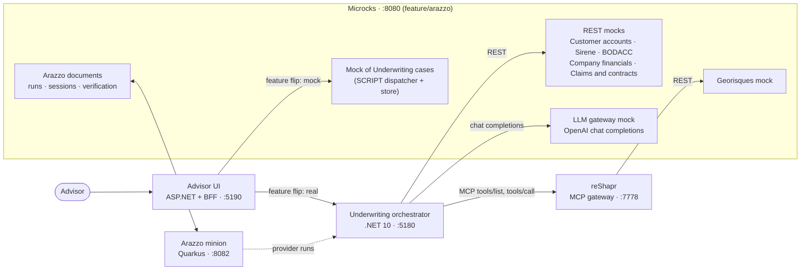
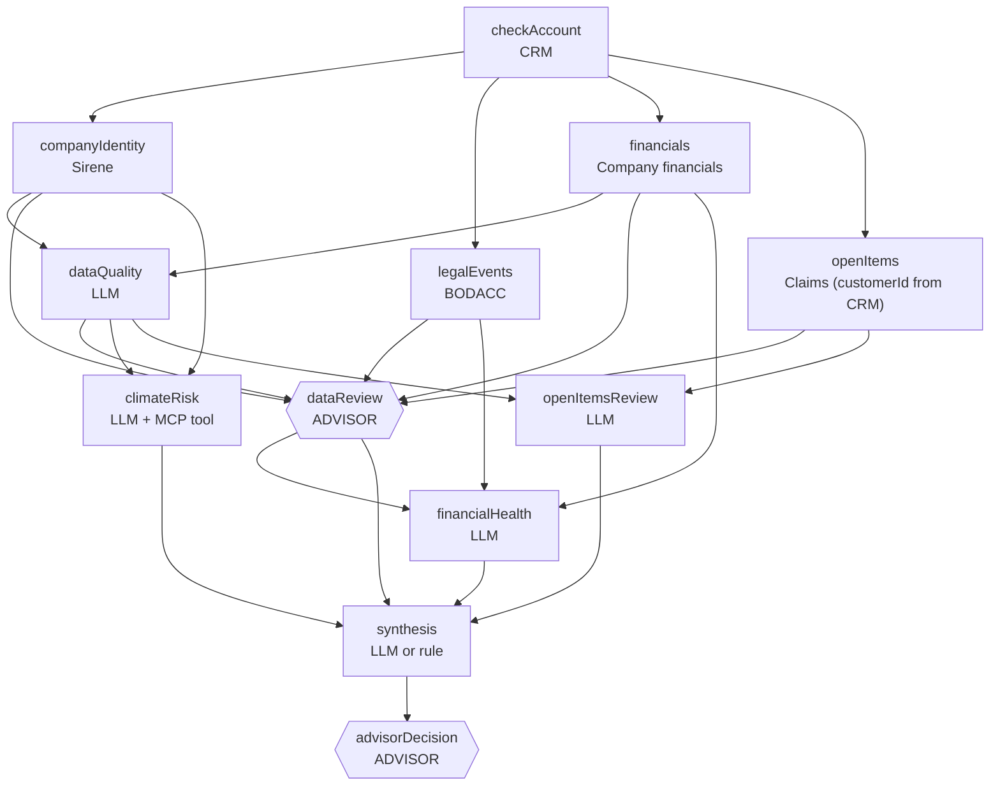
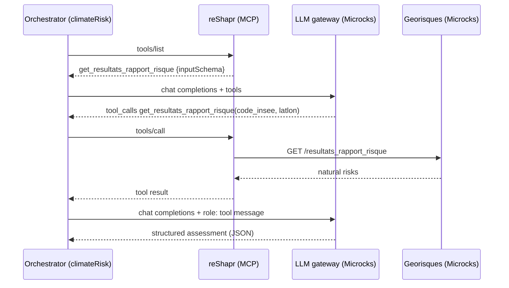
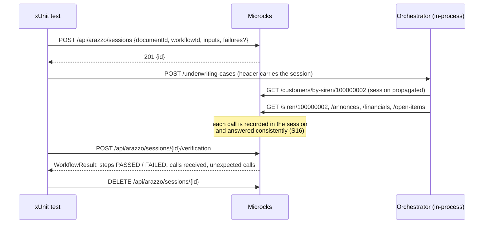

# Microcks × Arazzo — commercial insurance underwriting demo

**English** · [Français](README.fr.md)

A complete, runnable demo of [Arazzo](https://spec.openapis.org/arazzo/latest.html) workflows in
[Microcks](https://microcks.io), on a realistic case: an underwriting advisor opens a *Multirisk Pro* insurance case for
a company. A .NET orchestrator calls government and internal APIs, and LLM analysts, in sequence or in parallel. The
advisor stays at the heart of the case: they validate the collected data and take the final decision. The LLM analyses
only advise.

Microcks plays every part around the orchestrator:

| # | Microcks role | Where |
|---|---|---|
| 1 | **Mocks real APIs**: CRM, Sirene (INSEE), BODACC, Géorisques, company financials, claims | `contracts/*.openapi.yaml` |
| 2 | **Mocks an LLM**: an OpenAI-compatible chat completions API, tool calls included | `contracts/llm-gateway.openapi.yaml` |
| 3 | **Backs an MCP server**: reShapr exposes the Géorisques API as MCP tools, and Microcks simulates the API behind it | `tools/reshapr/` |
| 4 | **Impersonates the orchestrator**: a stateful, time-driven mock of the orchestrator API, behind a feature flip in the UI | `contracts/underwriting-cases.openapi.yaml` |
| 5 | **Tests the orchestrator as a provider**: Arazzo workflows play the advisor's journey against the orchestrator | `contracts/underwriting.arazzo.yaml` |
| 6 | **Verifies the orchestrator as a consumer**: in a session, Microcks checks that the orchestrator's outgoing calls follow an Arazzo workflow (order, data passed between steps, contract of each call), with injected failures | `tests/UnderwritingOrchestrator.WorkflowTests/` |

> [!IMPORTANT]
> Arazzo support is not in a Microcks release yet. This demo needs Microcks built from the `feature/arazzo` branch of
> [SebastienDegodez/microcks](https://github.com/SebastienDegodez/microcks/tree/feature/arazzo) (checked at commit
> `2e6dde48`). See [Prerequisites](#prerequisites).

## Contents

- [The business scenario](#the-business-scenario)
- [Architecture](#architecture)
- [The orchestrator](#the-orchestrator)
- [The contracts and their mocks](#the-contracts-and-their-mocks)
- [Arazzo, provider side: the advisor's journey](#arazzo-provider-side-the-advisors-journey)
- [Arazzo, consumer side: sessions and the .NET tests](#arazzo-consumer-side-sessions-and-the-net-tests)
- [The advisor UI](#the-advisor-ui)
- [Prerequisites](#prerequisites)
- [Running the demo](#running-the-demo)
- [Running the tests](#running-the-tests)
- [Configuration](#configuration)
- [Scripts](#scripts)
- [Repository layout](#repository-layout)
- [Known limitations](#known-limitations)
- [Troubleshooting](#troubleshooting)

## The business scenario

The advisor picks a company by its SIREN (French company number) and opens a case. The orchestrator then:

1. checks that the company is a **customer** (CRM); if it is not, the case stops at once;
2. **collects data** in parallel: legal identity (Sirene), legal announcements (BODACC), financial statements, open
   claims and contracts;
3. has an LLM analyst assess the **data quality**;
4. waits for the **advisor to validate the data**, and to correct the declared headcount if needed;
5. runs the **analyses**: climate risk (an LLM agent that calls an MCP tool to read the natural risks), financial
   health, open items;
6. produces an **advisory suggestion** (`synthesis`), by an LLM or by a rule;
7. waits for the **advisor's decision**. When the risk is too high for several reasons, the decision is *reinforced*:
   the advisor must acknowledge each reason one by one and write a comment.

Latency is long and random, as with real services: the financial statements take 30 to 60 seconds, for example. That
latency comes from Microcks (`delay` and `delayStrategy` in the contracts), not from the orchestrator.

### Demo companies

The data is consistent across every mock.

| SIREN | Company | City | What happens | Expected suggestion |
|---|---|---|---|---|
| `100000001` | Boulangerie Les Délices du Port | La Rochelle | Healthy, but **high coastal flooding** risk | `ACCEPT_WITH_SURCHARGE`, +15 % |
| `100000002` | Atelier Mécanique Durand | Clermont-Ferrand | Healthy, low risks | `ACCEPT` |
| `100000003` | Transports Express Nord | Lille | **Receivership** at the BODACC: the orchestrator calls no LLM | `REFUSE` (rule) |
| `100000004` | Restaurant Le Vieux Moulin | Avignon | Fragile finances, clay soil, **3 open claims including 1 in litigation**, inconsistent headcount | `REVIEW`, reinforced decision |
| `999999999` | (unknown) | — | **Not a customer**: the case stops after the first step | `NOT_ELIGIBLE` (rule) |

## Architecture



- **Orchestrator** (`orchestrator/`): an ASP.NET Core minimal API. All its dependency URLs are configuration, so it can
  point at Microcks mocks or at real APIs.
- **UI** (`ui/`): static HTML, CSS and ES modules served by a minimal ASP.NET host, plus a BFF that forwards to either
  backend. No front-end build step.
- **Microcks**: the webapp on port 8080 holds the mocks, the Arazzo documents, the runs and the sessions.
- **Arazzo minion**: a Quarkus worker on port 8082 that plays a workflow (provider runs). The consumer-side verification
  does not need it.
- **reShapr** ([reshapr.io](https://github.com/reshaprio/reshapr)): turns an OpenAPI API into an MCP server. Here it
  exposes the Géorisques API, which Microcks simulates behind it.

## The orchestrator

`orchestrator/` implements `contracts/underwriting-cases.openapi.yaml` on port **5180**.

| Endpoint | Response |
|---|---|
| `POST /underwriting-cases` `{siren, product}` | 202 `{caseId: "case-<siren>", status: "IN_PROGRESS"}` |
| `GET /underwriting-cases/{caseId}` | the case: `status`, `pendingAction`, `steps` (with `dependsOn` and `calls`), `recommendation`, `escalation`… |
| `POST /underwriting-cases/{caseId}/data-review` `{confirmed, corrections: {declaredHeadcount?}, comment}` | 200 the case; 409 `NOT_EXPECTED` outside `DATA_REVIEW` |
| `POST /underwriting-cases/{caseId}/advisor-decision` `{finalDecision, surchargePercent?, comment, acknowledgedReasons?}` | 200 the case, `DECIDED`; 400 `REASONS_NOT_ACKNOWLEDGED` or `COMMENT_REQUIRED`; 409 `NOT_EXPECTED` outside `DECISION` |

Cases are kept in memory, one live case per SIREN.

### Scheduling by dependencies

Each step starts **as soon as the steps of its `dependsOn` are done**. There are no blocking phases: the phase number
only serves the display. Dependencies are declared in `orchestrator/Cases/StepCatalog.cs` and exposed in the JSON.



`climateRisk` and `openItemsReview` may start before the advisor validates the data. `financialHealth` may not:
financial data is sensitive.

The case `status` is recomputed at every change: `IN_PROGRESS` while an automatic step runs, is queued or can still
start; `WAITING_ADVISOR` when every remaining step waits for the advisor. `pendingAction` (`DATA_REVIEW`, `DECISION` or
`null`) appears as soon as the action is possible.

Rules the orchestrator applies:

- **Unknown customer** (CRM 404): every other step is `SKIPPED`, the suggestion is `NOT_ELIGIBLE` from a rule, and the
  advisor still confirms it.
- **Collective procedure** at the BODACC: the data is collected and validated, but no LLM or MCP is called. The
  LLM steps are `SKIPPED` and `synthesis` becomes a `REFUSE` rule. Each LLM step checks the BODACC before calling the
  model.
- **No retry**: a failed call fails its step. Each of the 5 APIs is called once per case, the CRM first.
- **Staggered starts**: a step that is ready waits 0.3 to 5 s before it starts.
- **LLM queue**: at most 2 LLM calls at a time per case. Beyond that, a step is `QUEUED`.

### The climate agent calls the MCP tool itself

The chain is: climate agent (LLM) → reShapr (MCP) → Géorisques API (Microcks mock). `climateRisk` is a generic tool
calling loop (`orchestrator/Agents/ToolUsingAgent.cs`):



The MCP client speaks Streamable HTTP (JSON-RPC, protocol `2025-06-18`, `Mcp-Session-Id`). It has no tool name
hard-coded: the model picks the tool from `tools/list`. The mocked LLM knows how to ask for a tool: for the
`climate-risk` agent, it answers with `tool_calls` until the request carries a `role: tool` message.

### Reinforced decision

Before the decision, a deterministic rule (`orchestrator/Underwriting/RiskEscalation.cs`, not an LLM) collects the risk
reasons: `UNKNOWN_CUSTOMER`, `COLLECTIVE_PROCEDURE`, `CLIMATE_HIGH`, `FINANCIAL_FRAGILE`, `OPEN_LITIGATION`,
`DATA_INCONSISTENT`. The level is `REINFORCED` from 2 reasons, or as soon as the customer is unknown or under a
collective procedure. The decision then requires every reason in `acknowledgedReasons`, plus a comment.

## The contracts and their mocks

All contracts are generated by `scripts/generate-contracts.py`. Edit the generator, not the YAML files.

| Microcks name (`info.title` 1.0.0) | Role | Operations |
|---|---|---|
| `Customer accounts` | internal CRM | `GET /customers/by-siren/{siren}` → 200, or 404 `CUSTOMER_NOT_FOUND` |
| `Sirene` | INSEE company register | `GET /siren/{siren}` |
| `BODACC` | legal announcements | `GET /annonces?siren={siren}` |
| `Georisques` | natural risks (also exposed in MCP by reShapr) | `GET /resultats_rapport_risque?code_insee=…&latlon=…` |
| `Company financials` | financial statements | `GET /companies/{siren}/financials` |
| `Claims and contracts` | internal claims and contracts | `GET /customers/{customerId}/open-items` |
| `LLM gateway` | OpenAI-compatible LLM | `POST /v1/chat/completions` (`operationId: createChatCompletion`) |
| `Underwriting cases` | the orchestrator itself | the 4 endpoints above |

Some mock techniques the demo relies on:

- **Dispatching the LLM**: the orchestrator adds `metadata: {agent, siren}` to every chat completion. A `SCRIPT`
  dispatcher reads it and picks the example `<agent>-<siren>`, for example `climate-risk-100000001`. Set
  `LlmGateway:SendMetadata=false` for a real provider that refuses the field.
- **Latency**: each operation declares `x-microcks-operation.delay` and `delayStrategy` (`fixed`, `random`,
  `random-XX`). A caller can also ask for a latency per request with the `x-microcks-delay` and
  `x-microcks-delay-strategy` headers. reShapr forwards them to the Géorisques mock.
- **The orchestrator mock** (`Underwriting cases`): a `SCRIPT` dispatcher with the Microcks store. `POST` records the
  start time and random durations; `GET` picks the snapshot from the elapsed time; the two advisor `POST`s record their
  time and answer 409 out of turn. It behaves like the real orchestrator, timing included.

## Arazzo, provider side: the advisor's journey

`contracts/underwriting.arazzo.yaml` (*Commercial underwriting*, Arazzo 1.1.0) and its overlay
`contracts/underwriting.arazzo-sources.yaml` (`kind: ArazzoSources`). The overlay links each source to a Microcks API
by name and version, and holds the named examples (one per SIREN). The Arazzo document itself is never modified at
import.

The workflow **plays the advisor**: it opens a case, waits with `retry` (every 2 s) until the expected action is there,
posts the data validation, then the decision. Arazzo thus checks that the orchestrator **stops and waits for the human**
at the right places. At `DATA_REVIEW`, for example, it checks that `financialHealth` is still `PENDING`.

| Workflow | What it checks |
|---|---|
| `advisorValidatesThenDecides` | The full journey; the advisor follows the suggestion; `DECIDED` |
| `advisorOverridesSuggestion` | The advisor departs from the suggestion with a comment; `followsRecommendation == false` |
| `decisionWithoutCommentIsRefused` | Departing from the suggestion without a comment → 400 |
| `noDecisionBeforeDataReview` | A decision posted during `DATA_REVIEW` → 409 |
| `unknownCustomerNeedsNoAnalysis` | `999999999` → straight to `DECISION`, everything `SKIPPED`, `NOT_ELIGIBLE` |
| `highRiskRequiresReinforcedDecision` | `100000004` → `REINFORCED`; a decision without the reasons → 400; with them → `DECIDED` |
| `collectiveProcedureSkipsAnalyses` | `100000003` → analyses `SKIPPED`, `REFUSE` from a rule |

The same workflows run **against the real orchestrator** (target: implementation `http://localhost:5180`) and **against
the Microcks mock of the orchestrator** (target: mocks). `scripts/run-arazzo.sh` replays every named example against
the mock.

> [!NOTE]
> With several source descriptions, Microcks requires each `operationId` to name its source:
> `$sourceDescriptions.underwritingApi.createUnderwritingCase`, not `createUnderwritingCase`.

## Arazzo, consumer side: sessions and the .NET tests

The provider side checks what the orchestrator *answers*. The consumer side checks what it *calls*: did it call the CRM
first, pass the CRM's `customerId` to the claims API, skip no source, stop after a 404?

### How a session works



- The session travels on each call to the mocks in the `x-microcks-session: <id>` header, or in the W3C baggage
  `baggage: microcks-session=<id>`.
- Microcks checks the **order** of the calls (relaxed by `dependsOn`), the **data** passed between steps (a parameter
  that must come from `$steps.checkAccount.outputs.customerId` must carry that value), and the **contract** of each
  call.
- **Consistent mocks** (S16): within a session, the mocks reflect the values the application sent and the outputs of
  earlier steps.
- **Injected failures** (S17): `failures: {<stepId>: <example>}` makes one step answer with a given example, for this
  session only. That is how a test simulates an unknown customer or a collective procedure.

The workflows used here:

- `orchestratorCollectsCompanyData` (*Commercial underwriting*): `checkAccount`, then `companyIdentity`, `legalEvents`,
  `financials` and `openItems` with `dependsOn: [checkAccount]`. `openItems.customerId` must come from
  `$steps.checkAccount.outputs.customerId`.
- `customerUnknownStopsTheCase` (*Commercial underwriting*): `checkAccount` answers 404, and no other call may follow.
- `collectiveProcedureStopsTheAnalyses` (*Commercial underwriting guards*, `contracts/underwriting-guards.arazzo.yaml`):
  that document also links the `LLM gateway`, so a single LLM call after a collective procedure is reported as an
  unexpected call.

### Propagating the session without touching the orchestrator

The tests run the real orchestrator in-process with `WebApplicationFactory<Program>`. The orchestrator gets no new line
of code: the test adds the propagation from outside
(`tests/UnderwritingOrchestrator.WorkflowTests/Infrastructure/MicrocksSessionPropagation.cs`):

- an `IStartupFilter` reads the session of the incoming request (header or baggage) into an `AsyncLocal`, which flows
  into the background work of the case;
- `ConfigureHttpClientDefaults` adds a `DelegatingHandler` to every `IHttpClientFactory` client (REST, MCP and LLM)
  that writes `x-microcks-session` on each outgoing call.

> [!TIP]
> In .NET 10, the **W3C baggage propagates on its own**: a case posted with `baggage: microcks-session=<id>` to an
> orchestrator *without* the handler still carries the session on its 11 outgoing calls (5 REST, 6 LLM), including the
> calls made after the data review. The `x-microcks-session` header alone does not propagate without help.

### The tests

`tests/UnderwritingOrchestrator.WorkflowTests/` (xUnit v3, `Microcks.Testcontainers`,
`Microsoft.AspNetCore.Mvc.Testing`). Each test opens its own session and its own orchestrator, so the suite runs in
parallel in about 15 seconds.

| Test | What it shows |
|---|---|
| `TheUnderwritingOrchestratorFollowsTheWorkflow` | A whole case, green, even when the 4 collection calls arrive in a different order |
| `AnOrchestratorThatSendsTheSirenToClaimsIsCaught` | Planted bug: the claims are fetched with the SIREN. The mock answers 200, the orchestrator sees nothing wrong, the verification says `` `openItems` path `customerId` should come from `$steps.checkAccount.outputs.customerId` (C-1002), got 100000002 `` |
| `AnOrchestratorThatSkipsBodaccIsCaught` | Planted bug: a "cache" answers instead of the BODACC → `` step `legalEvents` missing `` |
| `AnOrchestratorThatSendsTheSiretToSireneIsCaught` | Planted bug: Sirene gets the SIRET → `` `companyIdentity` path `siren` should come from `$inputs.siren` ``… |
| `TheOrchestratorApiHonoursTheAdvisorJourney` | Provider side: a run started through the Microcks API plays the advisor's journey against the orchestrator, while a session verifies its outgoing calls (needs the Arazzo minion) |
| `AnUnknownCustomerStopsTheCase` | Injected CRM 404: that call only, nothing after |
| `ACollectiveProcedureStopsTheAnalyses` | Injected collective procedure: the 5 collection calls, no LLM call |
| `TwoCasesInParallelStayIsolated` | Two sessions at the same time on the same mocks: the failure injected in one never reaches the other |

The planted bugs are `DelegatingHandler`s added to the orchestrator's typed `CompanyDataApis` client
(`Infrastructure/Sabotage.cs`), so the orchestrator's code stays untouched.

## The advisor UI

`ui/` on port **5190**: the advisor's workstation.

- **Feature flip** in the header: *.NET orchestrator ⇄ Microcks (mock)*, kept in `localStorage`, with a badge that always
  says which backend answered.
- **The advisor's two checkpoints**: the data validation (collected data, data quality alerts, headcount correction)
  and the decision (the advisor chooses; the suggestion stays aside, labelled advisory; in `REINFORCED`, each reason is
  acknowledged one by one).
- **Tabs**: 360° view, Company, Risks (with an illustrative map drawn by the page, no external tiles), Finances,
  Claims & contracts, Timeline (lanes over time with `dependsOn` arrows and the LLM queue), Board, Call log.
- **"Understand" mode**: a side panel that animates the real calls at each poll: request packets, the Microcks frame,
  reShapr outside it, the advisor's POSTs. In mock mode, only the UI ⇄ Microcks exchange moves, because nothing is
  called downstream.

The BFF routes: `/bff/orchestrator/**` → `:5180`, `/bff/microcks/**` → the `Underwriting cases` mock, `/bff/health`.
URL parameters: `?backend=orchestrator|microcks`, `&comprendre=1`, `&tab=timeline`.

## Prerequisites

| Tool | Used for |
|---|---|
| .NET SDK 10 | orchestrator, UI, tests |
| Java 25 and Maven | building Microcks from `feature/arazzo` |
| Docker (Compose v2.24+) | MongoDB, reShapr, Testcontainers |
| Node.js, `curl`, `jq` | reShapr CLI, scripts |
| Python 3 | `scripts/generate-contracts.py` (only to regenerate the contracts) |

### Build Microcks with Arazzo

```bash
git clone -b feature/arazzo https://github.com/SebastienDegodez/microcks.git microcks-feature-arazzo
cd microcks-feature-arazzo
mvn -Pprod -DskipTests install

# Uber image, for the Testcontainers tests
docker build -f distro/uber/src/main/docker/Dockerfile -t microcks-uber:feature-arazzo distro/uber
```

### Run Microcks and the Arazzo minion

The demo expects Microcks on `http://localhost:8080` without authentication, and the Arazzo minion on
`http://localhost:8082`. One way, from the built jars:

```bash
docker run -d --name microcks-arazzo-mongo -p 27017:27017 mongo:4.4.29

KEYCLOAK_ENABLED=false ARAZZO_MINION_URL=http://localhost:8082 \
  java -jar webapp/target/microcks-app-*-exec.jar

java -Dquarkus.http.port=8082 -Dmicrocks.url=http://localhost:8080 \
  -jar minions/arazzo/target/quarkus-app/quarkus-run.jar
```

> [!NOTE]
> The webapp reads `arazzo-minion.url` without a default: always set `ARAZZO_MINION_URL`, even when no minion runs.

## Running the demo

```bash
scripts/start-demo.sh
```

The script checks Microcks and the minion, starts reShapr if needed (`scripts/start-reshapr.sh`), imports the contracts
(`scripts/import-contracts.sh`), then builds and starts the orchestrator and the UI.

| What | URL |
|---|---|
| Advisor UI | http://localhost:5190 |
| Orchestrator | http://localhost:5180 |
| Microcks workflows | http://localhost:8080/#/workflows (document *Commercial underwriting*) |
| reShapr console | http://localhost:5555 |
| MCP endpoint (reShapr) | http://localhost:7778/mcp/reshapr/georisques-1-0-0-default |

Stop with `scripts/stop-demo.sh` (orchestrator and UI), or `scripts/stop-demo.sh --all` (reShapr too). Microcks keeps
running.

### A suggested walkthrough

1. Open `100000002` with the real orchestrator and the *Understand* panel: the CRM first, then the 4 sources in
   parallel, the data quality analysis, then the case waits for you.
2. Validate the data: `financialHealth` starts only now, while `climateRisk` may already be done. Follow the climate
   agent: `tools/list`, the model asking for the tool, reShapr, Géorisques, the model again.
3. Decide. Then open `100000004`: the decision is reinforced, with 4 reasons to acknowledge.
4. Open `100000003`: the collective procedure stops the analyses, no LLM is called.
5. Flip to *Microcks (mock)* and replay: same journey, but only the UI ⇄ Microcks exchange moves.
6. In Microcks, run `advisorValidatesThenDecides` against the orchestrator, then against the mock.
7. Run the tests: the 3 planted bugs are caught.

## Running the tests

```bash
cd tests/UnderwritingOrchestrator.WorkflowTests

# Testcontainers: Microcks starts in a container, the contracts are imported at startup
MICROCKS_IMAGE=microcks-uber:feature-arazzo dotnet test --logger "console;verbosity=detailed"

# Against the running stack (Microcks :8080, minion :8082, contracts imported)
../../scripts/import-contracts.sh
MICROCKS_URL=http://localhost:8080 dotnet test --logger "console;verbosity=detailed"

# One test, for the stage
MICROCKS_URL=http://localhost:8080 dotnet test --logger "console;verbosity=detailed" \
  --filter "FullyQualifiedName~AnOrchestratorThatSendsTheSirenToClaimsIsCaught"
```

Each test prints Microcks' verdict: the steps, then the calls received in the session.

| | Running stack | Testcontainers |
|---|---|---|
| Consumer side tests (7) | green | green |
| `TheOrchestratorApiHonoursTheAdvisorJourney` (provider side) | green | skipped: the Arazzo minion has no image yet |

## Configuration

The orchestrator reads `orchestrator/appsettings.json`. Any key can be overridden by an environment variable, for
example `Llm__MaxConcurrency=1`.

| Key | Default |
|---|---|
| `Services:CustomerAccounts`, `Sirene`, `Bodacc`, `CompanyFinancials`, `ClaimsAndContracts` | the Microcks mocks `http://localhost:8080/rest/<Name>/1.0.0/` |
| `Mcp:Georisques:Endpoint` | reShapr `http://localhost:7778/mcp/reshapr/georisques-1-0-0-default` |
| `LlmGateway:BaseUrl`, `ApiKey`, `Model`, `SendMetadata`, `TimeoutSeconds` | the mocked LLM `http://localhost:8080/rest/LLM+gateway/1.0.0/` |
| `LlmGateway:DelayOverrides:<agent>:{Delay,Strategy}` | `financial-health`: 50000 ms, `random-20` (40 to 60 s) |
| `Demo:MicrocksDelayOverride:{Delay,Strategy}` | empty; applies to every REST, MCP and LLM call |
| `Llm:MaxConcurrency`, `Llm:MaxToolRounds` | 2, 3 |
| `Orchestration:StartJitterMilliseconds:{Min,Max}` | 300, 5000 |
| `Orchestration:ServiceDelayMilliseconds`, `LlmDelayMilliseconds` | 0 (only useful against real APIs) |

A per-agent `DelayOverrides` entry wins over `Demo:MicrocksDelayOverride`. To make everything fast, set both to 0.

**Use Microcks' native MCP server** instead of reShapr (Microcks ignores the latency headers on that path):

```bash
Mcp__Georisques__Endpoint=http://localhost:8080/mcp/Georisques/1.0.0 dotnet run
```

**Plug in a real LLM** (`BaseUrl` without `/v1`):

```bash
LlmGateway__BaseUrl=https://api.openai.com LlmGateway__ApiKey=sk-... LlmGateway__Model=gpt-4o-mini \
LlmGateway__SendMetadata=false dotnet run
```

## Scripts

| Script | What it does |
|---|---|
| `scripts/start-demo.sh` | Starts reShapr if needed, imports the contracts, builds and starts the orchestrator and the UI |
| `scripts/stop-demo.sh [--all]` | Stops the orchestrator and the UI (`--all`: reShapr too) |
| `scripts/import-contracts.sh [file...]` | Imports the contracts, Arazzo documents and overlays into Microcks; idempotent |
| `scripts/generate-contracts.py` | Generates every file of `contracts/` |
| `scripts/verify-mocks.sh` | Checks that every mock answers for every SIREN with its contract latency, MCP included, then drives the orchestrator mock like an advisor (about 3 min) |
| `scripts/run-arazzo.sh [workflowId...]` | Replays the named examples of the Arazzo workflows against the mocks |
| `scripts/start-reshapr.sh` | Starts reShapr (Docker Compose) and exposes the Géorisques mock as an MCP endpoint |
| `scripts/stop-reshapr.sh [--purge]` | Stops reShapr (`--purge`: deletes its database volume) |

## Repository layout

```text
contracts/      OpenAPI contracts, Arazzo documents and ArazzoSources overlays (generated)
orchestrator/   .NET 10 underwriting orchestrator (minimal API)
  Cases/          case model, the 12 steps and their dependsOn, in-memory store
  Underwriting/   workflow, step runner, LLM queue, advisor endpoints, risk escalation, rules
  Dependencies/   REST clients, generic MCP client, OpenAI-compatible LLM client, Microcks latency headers
  Agents/         tool-calling agent loop and advisory prompts
ui/             advisor UI: ASP.NET host + BFF, wwwroot (no build), Playwright e2e tests
tests/          UnderwritingOrchestrator.WorkflowTests: consumer-side and provider-side Arazzo tests
tools/reshapr/  Docker Compose files and CLI for reShapr
scripts/        start, stop, import, verify, replay
SCENARIO.md     the detailed scenario, in French: the contract between contracts, orchestrator and UI
```

## Known limitations

- **One case per SIREN**: `caseId` is `case-<siren>`. Reposting a SIREN replaces the case, but the calls already
  started by the old one finish. Tests use one orchestrator per test.
- **Async steps are not run**: Microcks reads Arazzo 1.1 AsyncAPI sources but does not run their steps yet.
- **The Arazzo minion has no image**: provider-side runs need the minion started from its jar.
- **Mocks out of session**: some examples are picked in Microcks' storage order. For a SIREN no example knows, a case
  may mix several companies. Inside a session, the verification stays correct.
- Observed in Microcks `feature/arazzo`, still to be reported: `POST /api/arazzo/sessions` without `documentId` answers 500
  instead of 400; a run against implementations needs a base URL for every source of the document, even the sources
  the workflow does not call.

## Troubleshooting

| Symptom | Cause and fix |
|---|---|
| Import refused: `Ambiguous operationId …: the document has several source descriptions` | Qualify the `operationId` with its source: `$sourceDescriptions.<source>.<operationId>`. |
| Import of `*.arazzo-sources.yaml` refused: the Arazzo document is not imported | Import the Arazzo document first; `import-contracts.sh` keeps that order. |
| Microcks does not start: `arazzo-minion.url` cannot be resolved | Set `ARAZZO_MINION_URL`. |
| The verification reports every step `missing` and no call | The session did not reach the mocks. Check the header or the baggage on the outgoing calls. |
| `400 … no base URL for source …` when running against implementations | Pass a URL for every source of the document, mocks included. |
| The UI shows nothing in *Microcks (mock)* mode | The `Underwriting cases` mock is not imported: run `scripts/import-contracts.sh`. `/bff/health` tells which backend answers. |
| Port 7777 already taken | reShapr's gateway is mapped to 7778 here, on purpose. |

## Disclosure

This demo was built with the help of generative AI (Claude Code), under human review. It is a demo: the companies,
SIRENs and data are fictitious, and the design is only *inspired* by an insurer design system, with no real brand.
